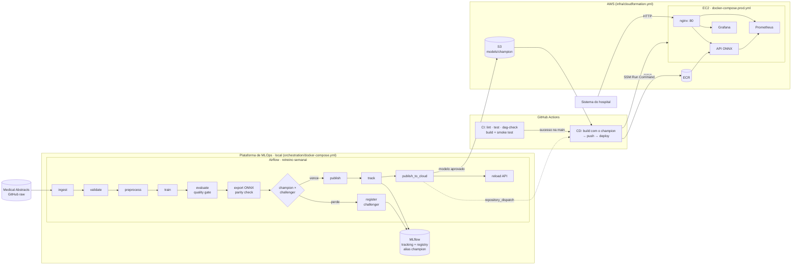
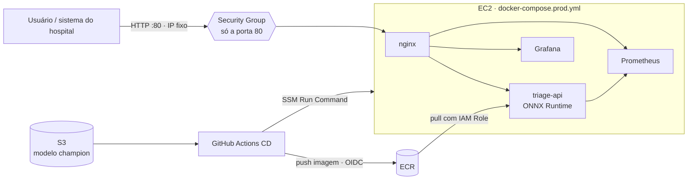

<div align="center">

# 🏥 Triagem Automática de Laudos Médicos

### FIAP Pós-Tech MLET · Tech Challenge · Fase 3 — Cloud & MLOps

**Classificador NLP de urgência (normal / atenção / urgente) em produção, com CI/CD,
retreino orquestrado, observabilidade e otimização de latência com ONNX Runtime.**


</div>

---

## 📋 Sumário

- [🌐 Demo online](#-demo-online)
- [🎯 Contexto](#-contexto)
- [🏆 Resultados](#-resultados)
- [🏗️ Arquitetura](#️-arquitetura)
- [☁️ Decisão de arquitetura em nuvem](#️-decisão-de-arquitetura-em-nuvem)
- [🚀 Quick Start](#-quick-start)
- [🧠 Dados e modelo](#-dados-e-modelo)
- [⚡ Otimização de latência (ONNX)](#-otimização-de-latência-onnx)
- [🔌 API](#-api)
- [📊 Monitoramento](#-monitoramento)
- [🔁 CI/CD](#-cicd)
- [🌬️ Orquestração com Airflow](#️-orquestração-com-airflow)
- [🧪 Rastreamento de experimentos (MLflow)](#-rastreamento-de-experimentos-mlflow)
- [🚀 Deploy na AWS](#-deploy-na-aws)
- [⚙️ Configuração](#️-configuração)
- [📁 Estrutura do projeto](#-estrutura-do-projeto)
- [🎓 Como este projeto atende ao desafio](#-como-este-projeto-atende-ao-desafio)
- [🎬 Vídeo](#-vídeo)

---

## 🌐 Demo online

A stack de produção está implantada na AWS (EC2 + nginx, endereço fixo, 24h) pelo pipeline de CD:

| Serviço | Endereço |
|---|---|
| **API (Swagger — teste o `POST /predict`)** | http://3.222.236.70/docs |
| Health check | http://3.222.236.70/health |
| Grafana (visualização anônima) | http://3.222.236.70/grafana/ |
| Prometheus | http://3.222.236.70/prometheus/ |

```bash
curl -X POST http://3.222.236.70/predict \
  -H "Content-Type: application/json" \
  -d '{"text": "Colon adenocarcinoma with liver metastasis, chemotherapy planned."}'
```

> Ambiente acadêmico mantido no ar durante o período de avaliação. Os textos de exemplo devem estar em
> inglês (idioma do corpus de treino).

---

## 🎯 Contexto

Um hospital de referência recebe um volume crescente de **laudos em texto livre**. Hoje a priorização
é manual: um laudo que descreve um infarto pode esperar na mesma fila que um exame de rotina. O objetivo
é um serviço que **classifique cada laudo assim que ele é emitido** em três níveis — `normal`,
`atencao` e `urgente` — para que a equipe clínica atue primeiro onde o risco é maior.

O foco da fase não é o modelo em si, mas **o ciclo de vida dele em produção**: API em container,
pipeline CI/CD, retreino orquestrado, monitoramento e latência.

> ⚠️ Projeto acadêmico. O classificador é um apoio à priorização, **não** substitui avaliação médica.

---

## 🏆 Resultados

| Indicador | Valor |
|---|---|
| Macro-F1 (teste, 2.246 laudos) | **0,727** (recall da classe `urgente`: 0,753) |
| Paridade sklearn × ONNX (rótulos) | **100%** no conjunto de teste |
| Latência do modelo, 1 laudo — média / p50 | 1,37 ms → **0,38 ms** (**3,6x**) · 1,32 → **0,35 ms** (**3,8x**) |
| Throughput do modelo, 1 laudo/chamada | 732 → **2.604 req/s** (**3,6x**) |
| Latência HTTP fim a fim (Docker, 8 clientes) — p95 | 65,8 ms → **52,5 ms** (**-20%**) |
| Throughput HTTP com 8 clientes | 162 → **205 req/s** (**+26%**) |
| Tamanho do artefato | 3,26 MB → **2,08 MB** |
| Overhead do nginx (proxy reverso) | ~0,5 ms no p50 |
| Testes | 58 testes (54 locais + 4 da DAG no CI), cobertura **98%** |

Relatórios completos: [`reports/latency.md`](reports/latency.md) (modelo isolado) e
[`reports/http_latency.md`](reports/http_latency.md) (API fim a fim).

---

## 🏗️ Arquitetura

O projeto separa três planos, como no mercado: **treino** (plataforma de MLOps, local), **entrega**
(GitHub Actions) e **serving** (EC2 na AWS, ou a mesma stack localmente).



Localmente, a mesma stack de serving roda com `docker-compose.yml` (que constrói a imagem e monta
`models/`), e a task `reload_api` recarrega o modelo novo na API local.

| Componente | Tecnologia | Papel |
|---|---|---|
| Modelo | TF-IDF (1–2 gramas) + Regressão Logística | Classificador leve, interpretável e rápido |
| Otimização | `skl2onnx` + ONNX Runtime | Pipeline inteiro (texto → probabilidades) em um grafo ONNX |
| Serviço | FastAPI + Uvicorn em Docker (multi-stage, não-root) | Inferência real-time |
| Proxy reverso | nginx | Porta única (80): roteia `/`, `/grafana/`, `/prometheus/`; bloqueia `/metrics` e `/admin/*` externamente |
| Métricas | `prometheus_client` (middleware próprio) | Requisições, latência, erros, inferência, classes |
| Observabilidade | Prometheus + Grafana provisionados | Dashboard com 11 painéis versionado em JSON |
| Orquestração | Airflow 2.10 (LocalExecutor) | Retreino com quality gate e publicação |
| Experimentos | MLflow 3 (tracking + Model Registry) | Histórico de cada retreino; alias `champion` = modelo em produção |
| CI/CD | GitHub Actions | CI: lint → test / dag-check → build + smoke · CD: champion do S3 → ECR → EC2 (SSM) |
| Infraestrutura | CloudFormation | ECR, S3, OIDC, EC2 com IP fixo e alerta de orçamento, tudo como código |

---

## ☁️ Decisão de arquitetura em nuvem

### Batch ou real-time?

| Critério | Batch | Real-time | Este caso |
|---|---|---|---|
| Quando o resultado é necessário | Horas depois | Segundos | **Imediato**: um laudo urgente não pode esperar o próximo job |
| Volume por requisição | Grandes lotes | 1 laudo por vez | Laudos chegam um a um, ao longo do dia |
| Peso do modelo | Pesado (GPU) | Leve | **Leve**: < 1 ms por laudo em CPU com ONNX |
| Consequência de atraso | Baixa | Alta | **Alta**: atraso na triagem = risco clínico |

**Decisão: inferência real-time (online), com treino em batch.** A pergunta clássica de "batch primeiro"
não se aplica aqui porque o valor do sistema está justamente em **reduzir o tempo até a priorização**.
O modelo é leve o bastante para servir em tempo real numa CPU comum, e o retreino (semanal) é
naturalmente batch.

### Arquitetura implantada: AWS EC2 + Docker Compose + nginx



Uma única instância roda a stack de serving com Docker Compose, com **IP Elástico** (endereço fixo) e
ligada 24h — o padrão já validado no Tech Challenge 1. O nginx é a única porta de entrada:

| Função | Como o nginx resolve |
|---|---|
| Porta única | Tudo entra pela 80; demais portas ficam só na rede interna do Docker |
| Roteamento por caminho | `/` → API · `/grafana/` → Grafana · `/prometheus/` → Prometheus |
| Proteção | `/metrics` e `/admin/*` bloqueados para a internet; limite de 1 MB por requisição; `server_tokens off` |
| Desempenho | Conexões *keep-alive* com a API (overhead medido: ~0,5 ms no p50) |

**Componentes AWS utilizados** (todos criados por [`infra/cloudformation.yml`](infra/cloudformation.yml)):

| Serviço | Papel no projeto |
|---|---|
| **EC2** + Security Group + **IP Elástico** | Servidor da stack de serving; só a porta 80 aberta; endereço fixo |
| **ECR** | Registry das imagens da API (scan de vulnerabilidades a cada push; mantém as 5 mais recentes) |
| **S3** | Modelo `champion` aprovado pelo pipeline de treino e pacotes de deploy (versionado e criptografado) |
| **IAM** (OIDC + roles) | O GitHub Actions entra na AWS por OIDC, sem chave guardada no repositório; a EC2 baixa imagens com a própria role |
| **SSM Run Command** | Deploy na EC2 sem porta 22 aberta e sem chave SSH |
| **CloudFormation** | Toda a infraestrutura versionada como código; `make infra-down` remove tudo |
| **AWS Budgets** | Alerta por e-mail se o gasto mensal passar do limite configurado |

**Por que essa arquitetura:**

- **Real-time sem cold start:** o container fica sempre carregado, com o modelo em memória e warm-up
  feito; a primeira requisição do dia responde tão rápido quanto as outras.
- **Imagem imutável:** cada imagem carrega um modelo fixo (tag `sha-<commit>-model-<versão>`), então
  voltar uma versão é apontar para a tag anterior.
- **Treino separado do serving:** Airflow e MLflow ficam na plataforma de MLOps (local), pesada e usada
  só no retreino semanal; o modelo aprovado chega à nuvem pelo S3, dentro da imagem construída pelo CD.
- **Simplicidade operacional:** um único `docker-compose.prod.yml`, o mesmo modelo de execução do
  ambiente local.

**Limites assumidos:** um único servidor (sem alta disponibilidade — se a instância cair, a API cai),
escala apenas vertical e deploy com alguns segundos de indisponibilidade. Para um ambiente hospitalar,
o caminho natural seria levar a mesma imagem para **ECS Fargate atrás de um Application Load Balancer**
(várias réplicas, autoscaling e deploy sem downtime), sem mudar o código.

**Alternativas avaliadas e descartadas:**

- **AWS Lambda:** o *cold start* de Python + onnxruntime (1–3 s) prejudica justamente o laudo urgente que
  chega com tráfego baixo, de madrugada.
- **SageMaker Real-time Endpoint:** pensado para modelos pesados (GPU, multi-model); superdimensionado para
  um modelo de < 1 ms em CPU.
- **ECS Fargate + ALB:** a evolução natural para alta disponibilidade, mas desnecessária para uma API de
  instância única neste projeto.
- **Batch (AWS Batch / SageMaker Batch Transform):** incompatível com o requisito de triagem imediata;
  serviria como complemento para reprocessar o histórico quando um novo modelo é publicado.

### Segurança e LGPD

Laudos são **dados pessoais sensíveis de saúde** (LGPD, art. 11). O que está implementado:

- A API **não persiste o texto dos laudos** e não registra conteúdo nos logs — só métricas agregadas.
- **Superfície mínima:** só a porta 80 exposta; endpoints internos (`/metrics`, `/admin/*`) bloqueados no
  nginx; nenhuma porta SSH aberta (acesso administrativo pelo SSM Session Manager).
- **Sem credenciais estáticas:** o CI/CD usa OIDC; a EC2 usa IAM Role; a senha do Grafana é gerada na
  própria instância.
- **Privilégio mínimo:** a role do CD só envia imagens ao ECR, lê/grava no bucket e faz deploy naquela
  instância; a role da EC2 só lê imagens e os pacotes de deploy.
- **Criptografia em repouso:** S3 e disco da EC2 criptografados; container rodando com usuário não-root e
  código somente leitura.
- **Rastreabilidade:** `metadata.json` e MLflow registram a versão, as métricas e o hash do dataset de cada
  modelo publicado.

> A demo usa HTTP (sem domínio próprio). Em um ambiente real, o tráfego seria HTTPS e restrito à rede do
> hospital (VPN/Direct Connect).

---

## 🚀 Quick Start

**Pré-requisitos:** [uv](https://docs.astral.sh/uv/), Docker (com Compose) e `make` (opcional — os comandos
equivalentes estão no [`Makefile`](Makefile)).

```bash
# 1. Dependências
uv sync --all-extras

# 2. Plataforma de MLOps: Airflow + MLflow
make mlops-up                    # = docker compose -f orchestration/docker-compose.yml up -d --build

# 3. Treinar (dataset → validação → treino → quality gate → ONNX → publish → MLflow)
make train                       # = uv run python -m src.pipelines.train
                                 #   (ou dispare a DAG triage_training_pipeline no Airflow)

# 4. Serving: nginx + API + Prometheus + Grafana
make up                          # = docker compose up -d --build

# 5. Testes e lint
make test
make lint

# 6. Gerar tráfego para ver o dashboard
make traffic                     # 5 min de tráfego com 3% de requisições inválidas

# 7. Benchmark de latência sklearn vs ONNX
make benchmark
```

| Serviço | URL | Acesso |
|---|---|---|
| API (Swagger) | http://localhost/docs | — |
| Grafana | http://localhost/grafana/ | anônimo (viewer) ou `admin` / `admin` |
| Prometheus | http://localhost/prometheus/ | — |
| MLflow | http://localhost:5000 | — (plataforma de MLOps) |
| Airflow | http://localhost:8080 | `airflow` / `airflow` (plataforma de MLOps) |

API, Grafana e Prometheus passam pelo nginx (porta 80). As portas diretas (`8000`, `3000`, `9090`)
continuam publicadas para depuração local; na EC2 só a 80 existe.

> 💡 **Windows/PowerShell:** use `curl.exe` (não o alias `curl`) e prefira `127.0.0.1` a `localhost` —
> no Windows, `localhost` tenta IPv6 primeiro e adiciona ~40 ms a cada chamada.

---

## 🧠 Dados e modelo

**Dataset:** [Medical Abstracts Text Classification Corpus](https://github.com/sebischair/Medical-Abstracts-TC-Corpus)
(Schopf et al., 2022) — 14.438 resumos médicos em inglês, rotulados em 5 categorias de doença. Baixado
automaticamente do GitHub (sem login). Após limpeza e deduplicação: **11.227 laudos**.

Como o corpus não traz urgência, as categorias foram mapeadas para níveis de triagem (mapeamento
*proxy*, configurável em [`params.yaml`](params.yaml)):

| Categoria original | Urgência | Justificativa |
|---|---|---|
| Doenças cardiovasculares | `urgente` | Eventos agudos tempo-dependentes (IAM, dissecção, arritmias) |
| Doenças do sistema nervoso | `urgente` | AVC, hemorragias, crises convulsivas |
| Neoplasias | `atencao` | Exigem seguimento rápido, mas raramente em minutos |
| Doenças do sistema digestivo | `atencao` | Espectro amplo, majoritariamente não emergencial |
| Condições patológicas gerais | `normal` | Achados gerais / inespecíficos |

Distribuição balanceada: 3.928 `urgente` · 3.741 `atencao` · 3.558 `normal`.

**Análise exploratória** ([`notebooks/01_eda.ipynb`](notebooks/01_eda.ipynb), reexecutável com `make eda`):
liga cada achado a uma decisão do pipeline. Os principais:

| Achado | Decisão |
|---|---|
| 5 categorias desbalanceadas (1.494 a 4.805) → 3 classes equilibradas após o mapeamento | Macro-F1 como métrica principal; `class_weight="balanced"` |
| **22% de duplicatas**, 91% delas com categorias conflitantes (corpus na prática multi-rótulo) | Deduplicação **antes** do split, para evitar *data leakage* |
| Textos com mediana de 170–186 palavras; tamanho não separa as classes | Modelo baseado em conteúdo (TF-IDF); limite de 20.000 caracteres na API |
| **24,6% dos textos `normal` têm termos de quadro agudo** (mais que `urgente`, 16,0%) | Limitação do rótulo *proxy*, documentada no model card |

**Modelo:** `TfidfVectorizer` (uni+bigramas, 50 mil termos) + `LogisticRegression(class_weight="balanced")`.
Um modelo linear sobre TF-IDF é a escolha certa para o requisito de latência: treina em segundos,
infere em sub-milissegundo em CPU e é explicável (pesos por termo).

| Classe | F1 |
|---|---|
| normal | 0,622 |
| atencao | 0,792 |
| urgente | 0,768 |
| **Macro-F1** | **0,727** |

A classe `normal` é a mais difícil: "condições patológicas gerais" é a categoria mais heterogênea do
corpus original (na literatura, é também a de pior F1). Detalhes, limitações e riscos no
[model card](docs/model_card.md).

---

## ⚡ Otimização de latência (ONNX)

Técnica aplicada: **conversão do pipeline completo para ONNX e inferência com ONNX Runtime**. O grafo
inclui tokenização, TF-IDF e o classificador — a API recebe texto e devolve probabilidades sem passar
pelo scikit-learn.

**Resultados — modelo isolado** (`make benchmark`, 2.000 laudos reais, após warm-up):

| Métrica | scikit-learn (original) | ONNX Runtime (otimizado) | Ganho |
|---|---:|---:|---:|
| Latência média (1 laudo) | 1,365 ms | 0,384 ms | **3,6x** |
| p50 (1 laudo) | 1,324 ms | 0,352 ms | **3,8x** |
| p95 (1 laudo) | 1,779 ms | 0,606 ms | **2,9x** |
| p99 (1 laudo) | 2,213 ms | 0,898 ms | **2,5x** |
| Throughput (1 laudo/chamada) | 732 req/s | 2.604 req/s | **3,6x** |
| p95 (lote de 32) | 17,54 ms | 11,58 ms | 1,5x |
| Tempo de carga | 411 ms | 231 ms | 1,8x |
| Tamanho do artefato | 3,26 MB | 2,08 MB | 1,6x menor |
| Macro-F1 (teste) | 0,7271 | 0,7271 | idêntico |

**Resultados — API fim a fim em Docker** (`make load-test`, 3.000 requisições):

| Cenário | Backend | Throughput | p50 | p95 | p99 |
|---|---|---:|---:|---:|---:|
| 1 cliente | scikit-learn | 69 req/s | 13,71 ms | 19,42 ms | 25,38 ms |
| 1 cliente | **ONNX Runtime** | **75 req/s** | **12,86 ms** | **17,34 ms** | **21,32 ms** |
| 8 clientes | scikit-learn | 162 req/s | 44,70 ms | 65,75 ms | 83,68 ms |
| 8 clientes | **ONNX Runtime** | **205 req/s** | **34,78 ms** | **52,53 ms** | **68,40 ms** |

> Os valores **absolutos** de HTTP dependem do estado da máquina (Windows + Docker Desktop, com antivírus e
> outros processos): ao longo do desenvolvimento, o mesmo código mediu de ~6 ms a ~13 ms no p50 com 1
> cliente — inclusive com a API fora do Docker. O que se mantém em todas as rodadas é a **comparação**,
> medida nas mesmas condições: ganho grande no modelo isolado e ganho que cresce sob concorrência na API.

**Por que o ganho é maior no modelo isolado do que na API?** O scikit-learn tem um custo fixo alto por
chamada (validação de entrada, matrizes esparsas SciPy, overhead Python) — exatamente o que domina quando
se classifica **um laudo por vez**, o padrão real-time. O ONNX Runtime executa o grafo em C++ sem esse
overhead. Na API, o tempo dentro do modelo (~1 ms) é pequeno perto do HTTP/serialização do cliente e do
servidor, que dilui o ganho com 1 cliente (~7%); sob concorrência, quando a CPU do modelo vira gargalo,
o ONNX volta a aparecer (+26% de throughput, -20% no p95). Em lotes, os dois se aproximam porque o
custo passa a ser a tokenização.

**Decisões técnicas da conversão** (cada uma validada por teste):

1. **Paridade como gate:** `export_onnx` compara rótulos sklearn × ONNX no conjunto de teste e falha a
   publicação se a concordância for < 99% (obtido: 100%).
2. **Tokenizador:** o `skl2onnx` gera a regex `[a-zA-Z0-9_]+` (mantém tokens de 1 caractere), enquanto o
   sklearn usa `\b\w\w+\b` — isso deslocava os bigramas e derrubava a paridade para 98,6%. Solução: regex
   ONNX explícita + normalização ASCII em `clean_text`.
3. **`sublinear_tf=False`:** a conversão do `sublinear_tf` no skl2onnx é inexata (diferenças de até 0,03
   nas probabilidades). Custou 0,5 p.p. de macro-F1 e garantiu probabilidades fiéis.
4. **`lowercase=False` no TF-IDF** (o `clean_text` já faz isso): evita o operador `StringNormalizer`,
   que exige o locale `en_US.UTF-8`, inexistente em imagens `slim` — a API quebrava no container.
5. **Sessão ONNX** com `ORT_ENABLE_ALL`, 1 thread intra-op (requisição pequena não ganha com paralelismo)
   e **warm-up** no startup da API.

A API serve os dois backends (`MODEL_BACKEND=onnx|sklearn`), o que permite comparar no mesmo container
e voltar ao original sem novo build.

---

## 🔌 API

| Método | Rota | Descrição |
|---|---|---|
| `POST` | `/predict` | Classifica um laudo |
| `POST` | `/predict/batch` | Classifica até 256 laudos em uma chamada |
| `GET` | `/health` | Liveness/readiness: modelo carregado, backend e versão |
| `POST` | `/admin/reload` | Recarrega o modelo do disco (usado pela DAG após publicar; bloqueado no nginx, só acesso interno) |
| `GET` | `/metrics` | Métricas no formato Prometheus (bloqueado no nginx, coletado pela rede interna) |

```bash
curl -X POST http://127.0.0.1/predict \
  -H "Content-Type: application/json" \
  -d '{"text": "Acute myocardial infarction with ST-segment elevation and severe chest pain."}'
```

```json
{
  "label": "urgente",
  "confidence": 0.7696,
  "probabilities": {"atencao": 0.0083, "normal": 0.2221, "urgente": 0.7696},
  "model_version": "20261102152746",
  "backend": "onnx",
  "latency_ms": 0.92
}
```

Validação: texto vazio, sem palavras ou acima de `MAX_TEXT_LENGTH` → `422`; modelo não carregado → `503`
(e `/health` responde `degraded` em vez de derrubar o container).

---

## 📊 Monitoramento

`docker compose up` sobe **API + Prometheus + Grafana** (atrás do nginx) com datasource
e dashboard **provisionados como código** — nenhum clique manual. Grafana em http://localhost/grafana/.

**Métricas expostas** ([`src/api/metrics.py`](src/api/metrics.py)):

| Métrica | Tipo | Labels |
|---|---|---|
| `http_requests_total` | Counter | `method`, `endpoint`, `status` |
| `http_request_duration_seconds` | Histogram (buckets a partir de 0,5 ms) | `method`, `endpoint` |
| `http_requests_in_progress` | Gauge | — |
| `model_inference_seconds` | Histogram (só o modelo, sem HTTP) | `backend` |
| `predictions_total` | Counter | `label` |
| `model_info` | Info | `version`, `backend` |

O label `endpoint` usa o template da rota (não o path cru) para limitar a cardinalidade, e `/metrics` e
`/health` ficam fora das contagens para não poluir os painéis.

**Dashboard "Triage API — Monitoramento"** ([JSON](monitoring/grafana/dashboards/triage_api.json)) — 11 painéis:

| Linha | Painéis |
|---|---|
| KPIs | Total de requisições · Taxa de erro · Latência p95 · Modelo em produção |
| Tráfego e latência | Requisições/s por endpoint e status · Latência HTTP p50/p95/p99 |
| Erros e modelo | Taxa de erro 4xx/5xx (%) · Tempo de inferência p50/p95 por backend |
| Negócio | Distribuição das predições (donut) · Predições por classe/s · Requisições em andamento |


> O painel "Distribuição das predições" funciona como um monitor simples de **drift**: uma mudança
> brusca na proporção de `urgente` sinaliza mudança nos dados de entrada ou um problema no modelo.

---

## 🔁 CI/CD

Dois workflows separados: **CI** valida todo push/PR; **CD** entrega e implanta só o que foi aprovado.

```
CI  (push/PR na main)          lint ──┬──► test ───────┐
                                      └──► dag-check ──┴──► build + smoke test
                                                                 │ sucesso na main
CD  (CI ok · modelo novo do Airflow · tag v* · manual)           ▼
     build: modelo champion do S3 ──► imagem ──► smoke test ──► push ECR
     deploy: liga a EC2 se preciso ──► bundle no S3 ──► SSM: compose pull/up ──► smoke test público
```

**[`ci.yml`](.github/workflows/ci.yml): integração contínua**

| Job | O que faz |
|---|---|
| **lint** | `ruff check` + `ruff format --check` em `src`, `tests`, `scripts`, `dags`; `cfn-lint` no template de infraestrutura |
| **test** | `pytest` com cobertura mínima de 70% (atual: 98%), offline com corpus sintético |
| **dag-check** | Instala Airflow 2.10.5 (constraints oficiais) e valida a DAG com `DagBag` |
| **build** | Treina no dataset real (com quality gate + paridade ONNX) → benchmark publicado no *Job Summary* → `docker build` → **smoke test** do container (`/health`, `/predict`, `/metrics`) |

**[`cd.yml`](.github/workflows/cd.yml): entrega e deploy contínuos**

| Gatilho | Quando |
|---|---|
| `workflow_run` do CI na `main` | Mudança de código — roda **apenas se o CI passou**, sobre o mesmo commit testado |
| `repository_dispatch` `model-published` | O Airflow aprovou e publicou um **modelo novo** no S3 |
| Tag `v*` / `workflow_dispatch` | Release (`1.0.0`, `1.0`) ou execução manual |

| Job | O que faz |
|---|---|
| **build** | Login na AWS via **OIDC** → baixa o modelo **`champion` do S3** (o aprovado pelo Airflow; se ainda não existir, treina) → constrói a imagem → smoke test → push no **ECR** com as tags `sha-<commit>-model-<versão>`, `sha-<commit>` e `latest` |
| **deploy** | Liga a EC2 se estiver parada → envia o *bundle* (compose de produção + nginx + monitoramento) ao S3 → executa [`scripts/ec2_deploy.sh`](scripts/ec2_deploy.sh) na instância via **SSM** → smoke test pela URL pública, publicada no *Job Summary* e no environment `production` |

**Sem as variáveis de AWS no repositório**, o CD continua útil: treina, constrói e publica a imagem no
GitHub Container Registry, e o job de deploy é pulado — o projeto funciona antes e depois de a
infraestrutura existir.

---

## 🌬️ Orquestração com Airflow

DAG [`dags/triage_training_dag.py`](dags/triage_training_dag.py) — `triage_training_pipeline`, semanal:

```
ingest_data → validate_data → preprocess → train_model → evaluate_model → export_onnx
            → compare_with_champion ─┬─ vence → publish_model → track_experiment → publish_to_cloud → reload_api
                                     └─ perde → register_challenger   (produção não muda)
```

| Task | Responsabilidade |
|---|---|
| `ingest_data` | Baixa o corpus (cache local) |
| `validate_data` | Mapeia rótulos, limpa e aplica o **contrato de dados** (schema, mínimo de 2.000 linhas, classes) |
| `preprocess` | Split estratificado treino/teste |
| `train_model` | Treina o pipeline e salva em `data/staging/` |
| `evaluate_model` | **Quality gate**: falha se macro-F1 < 0,60 |
| `export_onnx` | Converte para ONNX e falha se a paridade for < 99% |
| `compare_with_champion` | **Champion × challenger** (`BranchPythonOperator`): compara o candidato com o modelo em produção no mesmo conjunto de teste. Só segue para a publicação se `macro_f1` e `recall_urgente` não piorarem mais que a tolerância (`promotion` no `params.yaml`) |
| `register_challenger` | Caminho do perdedor: registra o candidato no MLflow com o alias **`challenger`** e o motivo da rejeição; `models/`, S3 e API continuam com o champion |
| `publish_model` | Grava `metadata.json` (versão, métricas, hash do dataset) e promove para `models/` |
| `track_experiment` | Registra o run no MLflow e promove a versão a `champion` no Model Registry (não falha o pipeline se o MLflow estiver fora) |
| `publish_to_cloud` | Envia o modelo para `s3://<bucket>/models/<versão>/` e `models/champion/` e dispara o CD (`repository_dispatch`). Sem `MODELS_BUCKET` configurado, não faz nada; configurado e com erro, **falha** (para não deixar a nuvem com o modelo antigo em silêncio) |
| `reload_api` | `POST /admin/reload` na API local (não falha se ela estiver fora) |

Um modelo só chega a `models/` (e à nuvem) se passar por **três verificações**: o quality gate
(absoluto: "é bom o suficiente?"), a paridade ONNX ("o otimizado responde igual?") e o champion ×
challenger (relativo: "é pelo menos tão bom quanto o atual?"). Caso contrário, a produção continua
com o modelo anterior. As tasks são wrappers finos de
[`src/pipelines/steps.py`](src/pipelines/steps.py): o mesmo código roda na CLI, no CI e no Airflow.

```bash
make mlops-up         # Airflow http://localhost:8080 (airflow / airflow) + MLflow http://localhost:5000
# Disparar: UI → triage_training_pipeline → ▶  ou:
docker compose -f orchestration/docker-compose.yml exec airflow-scheduler \
  airflow dags trigger triage_training_pipeline
```

<!-- TODO: adicionar print da Graph view do Airflow em docs/airflow_dag.png -->
> 📸 Print da execução da DAG: `docs/airflow_dag.png` _(a adicionar)_

---

## 🧪 Rastreamento de experimentos (MLflow)

Cada modelo publicado — pela CLI (`make train`) ou pela DAG — vira um **run no MLflow**
([`src/tracking/mlflow_tracking.py`](src/tracking/mlflow_tracking.py)):

| O que é registrado | Detalhe |
|---|---|
| Parâmetros | Hiperparâmetros do TF-IDF e da regressão logística (`params.yaml`) |
| Métricas | Acurácia, macro-F1, F1 por classe, recall de `urgente`, paridade ONNX, tamanho dos artefatos |
| Tags | Versão do modelo (a mesma do `metadata.json`), hash SHA-256 do dataset, classes |
| Artefatos | `model.joblib`, `metadata.json` e o **modelo ONNX** (flavor `mlflow.onnx`) |
| Model Registry | Modelo `triage-classifier`: a versão publicada recebe o alias **`champion`**; um candidato que perdeu a comparação recebe **`challenger`** (tag `promotion=rejected` com o motivo) |

Assim é possível comparar os retreinos semanais lado a lado na UI (http://localhost:5000) e saber
exatamente qual versão está em produção.


**Decisões de desenho:**

- **MLflow na plataforma de MLOps, junto do Airflow** (`orchestration/docker-compose.yml`), separado da
  stack de serving: o Airflow o acessa pelo nome do serviço (`http://mlflow:5000`) e o treino local por
  `http://127.0.0.1:5000`. Backend SQLite + `--serve-artifacts`: os clientes enviam tudo por HTTP.
- **No mercado**, o MLflow é uma plataforma compartilhada (Postgres/RDS + S3, ou gerenciado: Databricks,
  SageMaker MLflow). Aqui ele é local; o modelo aprovado chega à nuvem pelo S3 (`publish_to_cloud`).
- **A API não depende do MLflow:** ela continua lendo `models/`. O MLflow é a camada de rastreabilidade,
  não um ponto de falha do serving.
- **Tracking não bloqueia o pipeline:** sem `MLFLOW_TRACKING_URI` ou com o servidor fora do ar, o treino
  registra um aviso e segue (o quality gate e a paridade continuam obrigatórios). O cliente checa o
  `/health` do servidor antes, para não ficar minutos em *retry*.
- Cliente leve (`mlflow-skinny`) no treino e no Airflow; nenhum MLflow na imagem de inferência.

---

## 🚀 Deploy na AWS

Tudo é criado por código e pode ser apagado com um comando. A arquitetura está em
[☁️ Decisão de arquitetura em nuvem](#️-decisão-de-arquitetura-em-nuvem).

**Pré-requisitos:** conta AWS, [AWS CLI v2](https://docs.aws.amazon.com/cli/latest/userguide/getting-started-install.html)
configurado (`aws configure`) com um usuário que possa criar recursos IAM, e o repositório no GitHub
(o [`gh`](https://cli.github.com/) facilita o passo 2).

**1. Criar a infraestrutura** (ECR, S3, role OIDC, EC2 com IP fixo e alerta de orçamento):

```bash
make infra-up GITHUB_REPO=<dono>/<repositorio> BUDGET_EMAIL=<seu-email> ELASTIC_IP=true SCHEDULE=false
```

> `ELASTIC_IP=true SCHEDULE=false` é a configuração da demo: endereço fixo e instância ligada 24h. Sem
> esses parâmetros, o template não reserva IP fixo e liga/desliga a instância em horário comercial
> (EventBridge Scheduler), para ambientes de teste.

> Se a conta já tiver o provedor OIDC do GitHub (`token.actions.githubusercontent.com`), adicione
> `CreateGitHubOidcProvider=false` aos parâmetros. Confirme a inscrição no e-mail do AWS Budgets.

**2. Informar o CD** — copie os valores de `make infra-outputs` para as *variables* do repositório
(não são segredos: o acesso é garantido pela role OIDC, restrita a este repositório):

```bash
gh variable set AWS_REGION      --body us-east-1
gh variable set AWS_ROLE_ARN    --body <GitHubActionsRoleArn>
gh variable set ECR_REPOSITORY  --body <EcrRepositoryUri>
gh variable set MODELS_BUCKET   --body <ModelsBucketName>
gh variable set EC2_INSTANCE_ID --body <InstanceId>
```

**3. Primeiro deploy** — um push na `main` (ou `gh workflow run CD`). Como ainda não há modelo no S3, o CD
treina, constrói, envia ao ECR e implanta na EC2. A URL pública aparece no *Job Summary* e no
environment `production` do GitHub:

| Serviço | URL |
|---|---|
| API (Swagger) | `http://<ip-publico>/docs` |
| Grafana | `http://<ip-publico>/grafana/` (visualização anônima) |
| Prometheus | `http://<ip-publico>/prometheus/` |

**4. Ligar o retreino à nuvem (opcional, fecha o ciclo):**

```bash
# a) permissão para o Airflow (com as suas credenciais) enviar modelos ao bucket
aws iam attach-user-policy --user-name <seu-usuario-iam> --policy-arn <ModelPublisherPolicyArn>
# b) token do GitHub (fine-grained, "Contents: Read and write" neste repositório) para disparar o CD
# c) preencher orchestration/.env: MODELS_BUCKET, AWS_CONFIG_DIR (ex.: C:/Users/<voce>/.aws),
#    GITHUB_REPOSITORY e GITHUB_DISPATCH_TOKEN
make mlops-up
```

A partir daí, cada execução aprovada da DAG publica o modelo no S3 e dispara o CD, que implanta a nova
imagem na EC2 — **sem nenhum passo manual**.

**Operação:**

- **Disponibilidade:** com `ELASTIC_IP=true SCHEDULE=false`, a instância fica ligada 24h com endereço fixo
  (é a configuração da demo). Se o agendamento estiver ativo, o CD liga a instância para fazer um deploy
  fora do horário.
- **Shell na instância** (sem SSH): console EC2 → *Connect* → *Session Manager*, ou
  `aws ssm start-session --target <InstanceId>`.
- **Senha do admin do Grafana:** gerada na instância, em `sudo cat /opt/triage/.grafana_password`.
- **Rollback:** pela sessão SSM, aponte para uma tag anterior do ECR:
  `cd /opt/triage && sudo API_IMAGE=<ecr>:<tag-anterior> AWS_REGION=us-east-1 BUNDLE_URI=s3://<bucket>/deploy/<sha>/ bash ec2_deploy.sh`.

**5. Apagar tudo:**

```bash
make infra-down   # esvazia o bucket (todas as versões) e remove o stack inteiro
```

---

## ⚙️ Configuração

Variáveis de ambiente ([`.env.example`](.env.example)):

| Variável | Padrão | Descrição |
|---|---|---|
| `MODEL_BACKEND` | `onnx` | `onnx` (otimizado) ou `sklearn` (original) |
| `MODEL_DIR` | `models` | Pasta com `model.onnx`, `model.joblib` e `metadata.json` |
| `MAX_TEXT_LENGTH` | `20000` | Limite de caracteres por laudo |
| `LOG_LEVEL` | `INFO` | Nível de log |
| `MLFLOW_TRACKING_URI` | — (`make train` usa `http://127.0.0.1:5000`) | Servidor MLflow; vazio desliga o tracking |
| `MLFLOW_EXPERIMENT` | `triage-nlp` | Experimento no MLflow |
| `MLFLOW_REGISTERED_MODEL` | `triage-classifier` | Nome no Model Registry |
| `MODELS_BUCKET` | — | Bucket S3 de modelos; vazio deixa o pipeline 100% local |
| `AWS_REGION` | `us-east-1` | Região do bucket |
| `GITHUB_REPOSITORY` / `GITHUB_DISPATCH_TOKEN` | — | Repositório (`dono/nome`) e token para disparar o CD |
| `CA_BUNDLE` | — | Bundle de CA para redes com inspeção TLS |

Hiperparâmetros, mapeamento de rótulos, quality gate e paridade mínima ficam em [`params.yaml`](params.yaml).
O Airflow lê as variáveis de nuvem de `orchestration/.env` ([exemplo](orchestration/.env.example)); na EC2,
`PUBLIC_URL` e a senha do Grafana são gerados pelo script de deploy.

---

## 📁 Estrutura do projeto

```
├── .github/workflows/
│   ├── ci.yml                    # CI: lint → test/dag-check → build + smoke test
│   └── cd.yml                    # CD: champion do S3 → ECR → deploy na EC2 (SSM)
├── infra/cloudformation.yml      # infraestrutura AWS como código (ECR, S3, OIDC, EC2, IP fixo)
├── dags/triage_training_dag.py   # DAG Airflow de retreino (12 tasks, com branch champion × challenger)
├── orchestration/                # plataforma de MLOps local: Airflow + MLflow (compose, Dockerfile)
├── nginx/nginx.conf              # proxy reverso: /, /grafana/, /prometheus/
├── monitoring/
│   ├── prometheus.yml
│   └── grafana/                  # datasource + provider + dashboard JSON
├── src/
│   ├── config.py                 # Settings (.env) + params.yaml + constantes
│   ├── data/                     # download, limpeza de texto, contrato de dados, split
│   ├── models/                   # treino, export ONNX + paridade, backends de inferência
│   ├── evaluation/metrics.py     # métricas + quality gate
│   ├── pipelines/                # steps reutilizáveis + CLI de treino
│   ├── tracking/                 # MLflow: run, artefatos, Model Registry (champion)
│   ├── deploy/                   # publicação do modelo no S3 + disparo do CD
│   └── api/                      # FastAPI, schemas, métricas Prometheus
├── notebooks/01_eda.ipynb        # análise exploratória: achados → decisões do pipeline
├── scripts/
│   ├── benchmark.py              # latência offline sklearn × ONNX
│   ├── load_test.py              # carga HTTP fim a fim / tráfego para o Grafana
│   ├── ec2_deploy.sh             # roda na EC2 (via SSM): pull do ECR + compose up + health check
│   └── empty_bucket.py           # esvazia o bucket versionado antes de apagar o stack
├── tests/                        # 58 testes, fixtures offline
├── reports/                      # resultados de latência (md + json)
├── docs/                         # model card e prints
├── Dockerfile                    # multi-stage (uv), usuário não-root, healthcheck
├── docker-compose.yml            # serving local: nginx + API + Prometheus + Grafana
├── docker-compose.prod.yml       # serving na EC2: imagem do ECR, só a porta 80
├── params.yaml · pyproject.toml · uv.lock · Makefile
```

---

## 🎓 Como este projeto atende ao desafio

| Requisito | Onde | Status |
|---|---|---|
| Pipeline CI/CD (lint → test → build), ≥ 2 automações | [`ci.yml`](.github/workflows/ci.yml) (4 jobs) + [`cd.yml`](.github/workflows/cd.yml) (ECR + deploy na EC2) | ✅ |
| Script/DAG Airflow de treino (carregamento → treino → salvamento) | [`triage_training_dag.py`](dags/triage_training_dag.py) — quality gate, paridade ONNX e champion × challenger | ✅ |
| Dockerfile funcional do serviço de inferência | [`Dockerfile`](Dockerfile) — multi-stage, não-root, healthcheck | ✅ |
| Compose com API + Prometheus + Grafana | [`docker-compose.yml`](docker-compose.yml) | ✅ |
| Dashboard Grafana com ≥ 3 painéis | 11 painéis provisionados ([JSON](monitoring/grafana/dashboards/triage_api.json)) | ✅ |
| Instrumentação com `prometheus_client` (tempo e contagem) | [`src/api/metrics.py`](src/api/metrics.py) | ✅ |
| Otimização de performance vista em aula | ONNX Runtime — **3,6x** mais rápido no modelo, F1 idêntico | ✅ |
| Comparação de latência original × otimizado | [`reports/latency.md`](reports/latency.md), [`reports/http_latency.md`](reports/http_latency.md) | ✅ |
| Baseline de latência local em Docker | [`reports/http_latency.md`](reports/http_latency.md) | ✅ |
| Decisão arquitetural em nuvem (batch × real-time) | [Seção acima](#️-decisão-de-arquitetura-em-nuvem) — real-time em EC2 + nginx | ✅ |
| Deploy em nuvem funcionando | [🌐 Demo online](#-demo-online) — implantado pelo CD na AWS | ✅ |
| Extra: rastreamento de experimentos e registry | MLflow com alias `champion` ([seção](#-rastreamento-de-experimentos-mlflow)) | ✅ |
| Extra: proxy reverso | [`nginx/nginx.conf`](nginx/nginx.conf) | ✅ |
| Extra: infraestrutura como código e deploy automatizado | [`infra/cloudformation.yml`](infra/cloudformation.yml) + CD (OIDC, ECR, SSM) — [passo a passo](#-deploy-na-aws) | ✅ |
| Bibliotecas: Scikit-Learn, FastAPI, prometheus-client, Airflow | `pyproject.toml`, `orchestration/` | ✅ |
| Dataset com ≥ 2.000 amostras | 11.227 laudos (Medical Abstracts TC Corpus) | ✅ |
| Histórico de commits semântico | Conventional Commits (`feat`, `fix`, `perf`, `ci`, `docs`…) | ✅ |
| Vídeo STAR (≤ 5 min) | [Link abaixo](#-vídeo) | 🎬 |

---

## 🎬 Vídeo

📺 **[Link do vídeo de demonstração (STAR, 5 min)](#)** — _a ser adicionado_
