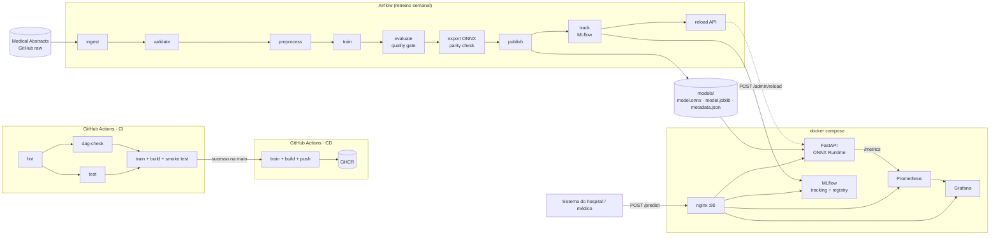
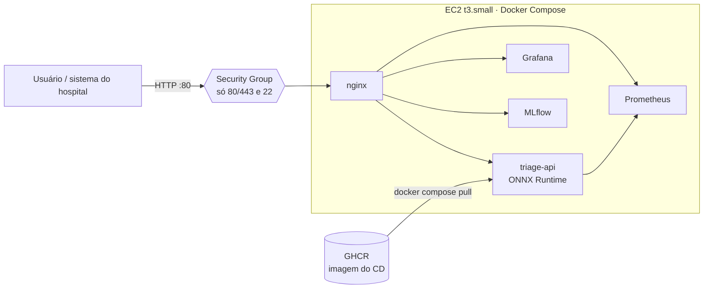
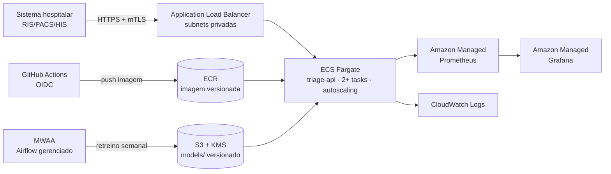
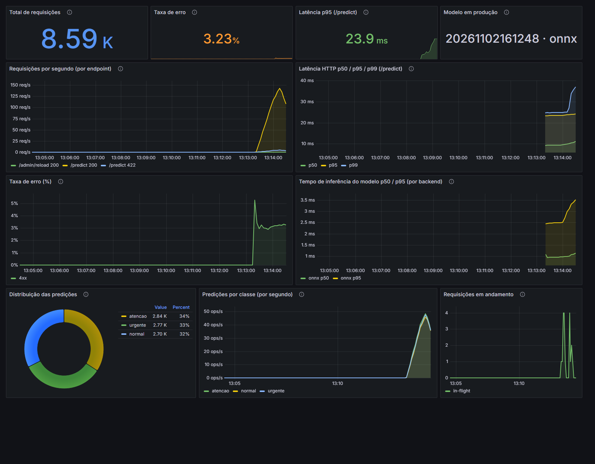
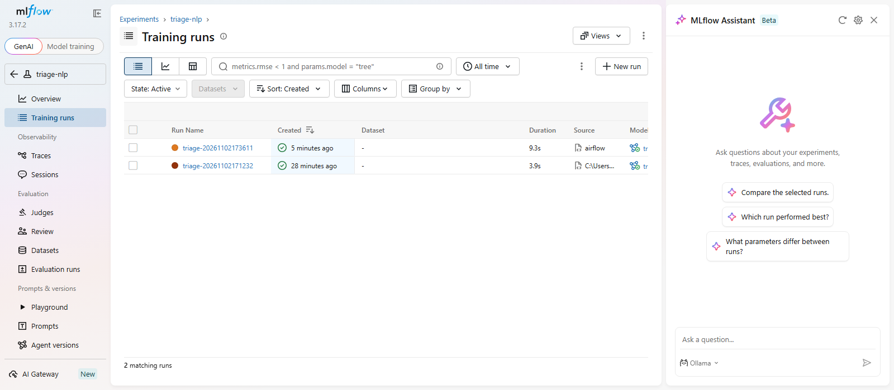

<div align="center">

# 🏥 Triagem Automática de Laudos Médicos

### FIAP Pós-Tech MLET · Tech Challenge · Fase 3 — Cloud & MLOps

**Classificador NLP de urgência (normal / atenção / urgente) em produção, com CI/CD,
retreino orquestrado, observabilidade e otimização de latência com ONNX Runtime.**


</div>

---

## 📋 Sumário

- [🎯 Contexto](#-contexto)
- [🏆 Resultados](#-resultados)
- [🏗️ Arquitetura local](#️-arquitetura-local)
- [☁️ Decisão de arquitetura em nuvem](#️-decisão-de-arquitetura-em-nuvem)
- [🚀 Quick Start](#-quick-start)
- [🧠 Dados e modelo](#-dados-e-modelo)
- [⚡ Otimização de latência (ONNX)](#-otimização-de-latência-onnx)
- [🔌 API](#-api)
- [📊 Monitoramento](#-monitoramento)
- [🔁 CI/CD](#-cicd)
- [🌬️ Orquestração com Airflow](#️-orquestração-com-airflow)
- [🧪 Rastreamento de experimentos (MLflow)](#-rastreamento-de-experimentos-mlflow)
- [⚙️ Configuração](#️-configuração)
- [📁 Estrutura do projeto](#-estrutura-do-projeto)
- [🎓 Como este projeto atende ao desafio](#-como-este-projeto-atende-ao-desafio)
- [🎬 Vídeo](#-vídeo)

---

## 🎯 Contexto

Um hospital de referência recebe um volume crescente de **laudos em texto livre**. Hoje a priorização
é manual: um laudo que descreve um infarto pode esperar na mesma fila que um exame de rotina. O objetivo
é um serviço que **classifique cada laudo assim que ele é emitido** em três níveis — `normal`,
`atencao` e `urgente` — para que a equipe clínica atue primeiro onde o risco é maior.

O foco da fase não é o modelo em si, mas **o ciclo de vida dele em produção**: API em container,
pipeline CI/CD, retreino orquestrado, monitoramento e latência.

> ⚠️ Projeto acadêmico. O classificador é um apoio à priorização, **não** substitui avaliação médica.

---

## 🏆 Resultados

| Indicador | Valor |
|---|---|
| Macro-F1 (teste, 2.246 laudos) | **0,727** (recall da classe `urgente`: 0,753) |
| Paridade sklearn × ONNX (rótulos) | **100%** no conjunto de teste |
| Latência do modelo, 1 laudo — p95 | 3,42 ms → **0,61 ms** (**5,6x**) |
| Throughput do modelo, 1 laudo/chamada | 477 → **2.551 req/s** (**5,3x**) |
| Latência HTTP fim a fim (Docker, 1 cliente) — p50 | 6,86 ms → **5,68 ms** |
| Throughput HTTP com 8 clientes | 200 → **257 req/s** (**+29%**) |
| Tamanho do artefato | 3,26 MB → **2,08 MB** |
| Overhead do nginx (proxy reverso) | ~0,5 ms no p50 |
| Testes | 41 testes (38 locais + 3 da DAG no CI), cobertura **98%** |

Relatórios completos: [`reports/latency.md`](reports/latency.md) (modelo isolado) e
[`reports/http_latency.md`](reports/http_latency.md) (API fim a fim).

---

## 🏗️ Arquitetura local



| Componente | Tecnologia | Papel |
|---|---|---|
| Modelo | TF-IDF (1–2 gramas) + Regressão Logística | Classificador leve, interpretável e rápido |
| Otimização | `skl2onnx` + ONNX Runtime | Pipeline inteiro (texto → probabilidades) em um grafo ONNX |
| Serviço | FastAPI + Uvicorn em Docker (multi-stage, não-root) | Inferência real-time |
| Proxy reverso | nginx | Porta única (80): roteia `/`, `/grafana/`, `/prometheus/`, `/mlflow/`; bloqueia `/metrics` externamente |
| Métricas | `prometheus_client` (middleware próprio) | Requisições, latência, erros, inferência, classes |
| Observabilidade | Prometheus + Grafana provisionados | Dashboard com 11 painéis versionado em JSON |
| Orquestração | Airflow 2.10 (LocalExecutor) | Retreino com quality gate e publicação |
| Experimentos | MLflow 3 (tracking + Model Registry) | Histórico de cada retreino; alias `champion` = modelo em produção |
| CI/CD | GitHub Actions | CI: lint → test / dag-check → train + build + smoke · CD: push GHCR |

---

## ☁️ Decisão de arquitetura em nuvem

### Batch ou real-time?

| Critério | Batch | Real-time | Este caso |
|---|---|---|---|
| Quando o resultado é necessário | Horas depois | Segundos | **Imediato**: um laudo urgente não pode esperar o próximo job |
| Volume por requisição | Grandes lotes | 1 laudo por vez | Laudos chegam um a um, ao longo do dia |
| Custo do modelo | Pesado (GPU) | Leve | **Leve**: < 1 ms por laudo em CPU com ONNX |
| Consequência de atraso | Baixa | Alta | **Alta**: atraso na triagem = risco clínico |

**Decisão: inferência real-time (online), com treino em batch.** A pergunta clássica de "batch primeiro"
não se aplica aqui porque o valor do sistema está justamente em **reduzir o tempo até a priorização**.
O modelo é leve o bastante para que o real-time não custe caro, e o retreino (semanal) é naturalmente
batch.

A arquitetura foi pensada em **duas camadas**: o que este projeto (educacional) implanta de fato, com
custo mínimo, e como ela evoluiria para a produção real de um hospital.

### Camada 1 — Implementação do projeto: AWS EC2 + Docker Compose + nginx



É o **mesmo `docker-compose.yml` do ambiente local**, numa única instância — o padrão já validado no
Tech Challenge 1. O nginx é a única porta de entrada e cumpre, em escala de um servidor, o papel que um
load balancer gerenciado teria:

| Função | Como o nginx resolve |
|---|---|
| Porta única | Tudo entra pela 80 (ou 443 com Let's Encrypt); demais portas fechadas no Security Group |
| Roteamento por caminho | `/` → API · `/grafana/` → Grafana · `/prometheus/` → Prometheus · `/mlflow/` → MLflow |
| Proteção | `/metrics` bloqueado para a internet; limite de 1 MB por requisição; `server_tokens off` |
| Desempenho | Conexões *keep-alive* com a API (overhead medido: ~0,5 ms no p50) |

**Por que EC2 aqui:** custo previsível e baixo (uma `t3.small`, ~US$ 15/mês ligada 24h — e pode ser
desligada fora das demonstrações), nenhum serviço gerenciado cobrando por hora, e reaproveita o
conhecimento do TC1. O **Airflow não vai para a EC2** (precisa de 2–4 GB de RAM sozinho): o retreino roda
localmente/sob demanda e o modelo chega à EC2 dentro da imagem publicada pelo CD.

**Deploy:**

```bash
# Na EC2 (Amazon Linux 2023 / Ubuntu) com Docker e o plugin compose instalados
git clone https://github.com/<usuario>/<repositorio>.git && cd <repositorio>
export PUBLIC_URL=http://<ip-publico-da-ec2> GRAFANA_ADMIN_PASSWORD=<senha-forte>
uv sync --all-extras && make train   # ou baixe o artefato "model-and-reports" do CI para models/
docker compose up -d --build
# Security Group: liberar 80 (e 443) para o mundo e 22 apenas para o seu IP
```

**Limites assumidos (aceitáveis para o projeto, não para o hospital):** um único servidor (sem alta
disponibilidade — se a instância cair, a API cai), escala apenas vertical e deploy com alguns segundos
de indisponibilidade.

### Camada 2 — Evolução para produção no hospital: ECS Fargate + ALB



| Camada | Serviço | Por quê |
|---|---|---|
| Registro de imagem | **Amazon ECR** | Destino natural do CD; scan de vulnerabilidades da imagem |
| Inferência | **ECS Fargate** atrás de **ALB** | Container sempre quente (sem cold start), sem gerenciar servidores, autoscaling por CPU/RPS, rolling/blue-green deploy |
| Artefatos | **S3** (versionamento + KMS) | Modelo versionado, rollback trivial, criptografia em repouso |
| Retreino | **MWAA** (Airflow gerenciado) | Reaproveita a mesma DAG deste repositório sem alterações de lógica |
| Observabilidade | **Amazon Managed Prometheus + Grafana** | Mesmas métricas e o mesmo dashboard JSON do ambiente local |
| CI/CD | GitHub Actions com **OIDC** | Sem chaves de longa duração no repositório |
| Experimentos | MLflow em ECS (ou SageMaker MLflow gerenciado) + RDS + S3 | Mesmo tracking/registry do projeto, com backend durável |

**O ALB substitui o nginx** quando há mais de um servidor: recebe HTTPS (certificado gratuito do ACM),
distribui as requisições entre as tasks de várias zonas de disponibilidade, consulta o `/health` da API
e tira de rotação a task que falhar, e só envia tráfego à nova versão depois que ela fica saudável
(deploy sem downtime). O **ECS Express Mode** cria esse conjunto (serviço Fargate + ALB + HTTPS +
autoscaling) a partir da imagem do container em um único passo.

**Quando vale pagar por isso:** o ALB custa ~US$ 16–25/mês (hora + capacidade + IPs) e duas tasks
Fargate de 0,5 vCPU / 1 GB, ~US$ 35/mês. Para o hospital, alta disponibilidade e deploy sem
indisponibilidade justificam o custo; para o projeto educacional, a Camada 1 entrega o mesmo
comportamento funcional por uma fração do preço.

**Alternativas avaliadas e descartadas:**

- **AWS Lambda** — viável (o modelo ONNX tem 2 MB), mas o *cold start* de Python + onnxruntime
  (1–3 s) é inaceitável justamente no laudo urgente que chega de madrugada, com tráfego baixo.
  Provisioned concurrency resolve, mas com custo similar ao Fargate e mais complexidade.
- **SageMaker Real-time Endpoint** — ótimo para modelos pesados (GPU, multi-model), mas é
  superdimensionado e mais caro para um modelo de < 1 ms em CPU.
- **AWS App Runner** — seria a opção mais simples, mas deixou de aceitar novos clientes em 30/04/2026;
  a AWS indica o ECS Express Mode como substituto.
- **Batch (AWS Batch / SageMaker Batch Transform)** — incompatível com o requisito de triagem
  imediata. Fica como complemento para **reprocessar o histórico** quando um novo modelo é publicado.

**Equivalentes em outras nuvens:** Azure Container Apps + ACR + Azure ML/Data Factory · GCP Cloud Run
(com `min-instances ≥ 1` para evitar cold start) + Artifact Registry + Cloud Composer.

### FinOps

- **Projeto (Camada 1):** uma EC2 `t3.small` desligada quando não está em uso; imagem no GHCR (gratuito);
  nenhum serviço gerenciado cobrando por hora. Dependendo da conta, os créditos de free tier cobrem o período.
- **Produção (Camada 2):** Fargate com 2 tasks de **0,5 vCPU / 1 GB** atende centenas de req/s (o modelo usa < 1 ms de CPU por laudo).
  Autoscaling mínimo 2 (alta disponibilidade), máximo conforme o pico.
- **Fargate Spot** para o ambiente de homologação; Savings Plans para produção.
- Retreino semanal em MWAA no menor ambiente (`mw1.small`) — ou, para reduzir custo fixo, a mesma
  DAG pode virar uma *ECS Scheduled Task*.
- A otimização com ONNX tem efeito direto em custo: **5x mais throughput por vCPU** significa menos tasks
  para o mesmo volume.

### Segurança e LGPD

Laudos são **dados pessoais sensíveis de saúde** (LGPD, art. 11):

- Serviço em **subnets privadas**, acessível apenas pela rede do hospital (VPN/Direct Connect) e com mTLS.
- **Criptografia** em trânsito (TLS) e em repouso (KMS em S3, ECR e logs).
- A API **não persiste o texto dos laudos** e não registra conteúdo nos logs — só métricas agregadas.
- IAM com privilégio mínimo (task role com leitura apenas do bucket de modelos), segredos no Secrets Manager.
- Dados de treino anonimizados; trilha de auditoria (CloudTrail) e `metadata.json` com hash do dataset de
  cada modelo publicado.

---

## 🚀 Quick Start

**Pré-requisitos:** [uv](https://docs.astral.sh/uv/), Docker (com Compose) e `make` (opcional — os comandos
equivalentes estão no [`Makefile`](Makefile)).

```bash
# 1. Dependências
uv sync --all-extras

# 2. Stack completa: nginx + API + Prometheus + Grafana + MLflow
#    (treina antes, se models/ estiver vazio)
make up                          # = docker compose up -d --build

# 3. Treinar (dataset → validação → treino → quality gate → ONNX → publish → MLflow)
make train                       # = uv run python -m src.pipelines.train

# 4. Testes e lint
make test
make lint

# 5. Gerar tráfego para ver o dashboard
make traffic                     # 5 min de tráfego com 3% de requisições inválidas

# 6. Benchmark de latência sklearn vs ONNX
make benchmark
```

Tudo é servido pelo nginx na porta 80:

| Serviço | URL | Acesso |
|---|---|---|
| API (Swagger) | http://localhost/docs | — |
| Grafana | http://localhost/grafana/ | anônimo (viewer) ou `admin` / `admin` |
| Prometheus | http://localhost/prometheus/ | — |
| MLflow | http://localhost/mlflow/ | — |
| Airflow | http://localhost:8080 | `airflow` / `airflow` (após `make airflow-up`) |

As portas diretas (`8000`, `3000`, `9090`, `5000`) continuam publicadas para depuração local e para o
treino/Airflow alcançarem o MLflow; na EC2, o Security Group expõe apenas a 80.

> 💡 **Windows/PowerShell:** use `curl.exe` (não o alias `curl`) e prefira `127.0.0.1` a `localhost` —
> no Windows, `localhost` tenta IPv6 primeiro e adiciona ~40 ms a cada chamada.

---

## 🧠 Dados e modelo

**Dataset:** [Medical Abstracts Text Classification Corpus](https://github.com/sebischair/Medical-Abstracts-TC-Corpus)
(Schopf et al., 2022) — 14.438 resumos médicos em inglês, rotulados em 5 categorias de doença. Baixado
automaticamente do GitHub (sem login). Após limpeza e deduplicação: **11.227 laudos**.

Como o corpus não traz urgência, as categorias foram mapeadas para níveis de triagem (mapeamento
*proxy*, configurável em [`params.yaml`](params.yaml)):

| Categoria original | Urgência | Justificativa |
|---|---|---|
| Doenças cardiovasculares | `urgente` | Eventos agudos tempo-dependentes (IAM, dissecção, arritmias) |
| Doenças do sistema nervoso | `urgente` | AVC, hemorragias, crises convulsivas |
| Neoplasias | `atencao` | Exigem seguimento rápido, mas raramente em minutos |
| Doenças do sistema digestivo | `atencao` | Espectro amplo, majoritariamente não emergencial |
| Condições patológicas gerais | `normal` | Achados gerais / inespecíficos |

Distribuição balanceada: 3.928 `urgente` · 3.741 `atencao` · 3.558 `normal`.

**Modelo:** `TfidfVectorizer` (uni+bigramas, 50 mil termos) + `LogisticRegression(class_weight="balanced")`.
Um modelo linear sobre TF-IDF é a escolha certa para o requisito de latência: treina em segundos,
infere em sub-milissegundo em CPU e é explicável (pesos por termo).

| Classe | F1 |
|---|---|
| normal | 0,622 |
| atencao | 0,792 |
| urgente | 0,768 |
| **Macro-F1** | **0,727** |

A classe `normal` é a mais difícil: "condições patológicas gerais" é a categoria mais heterogênea do
corpus original (na literatura, é também a de pior F1). Detalhes, limitações e riscos no
[model card](docs/model_card.md).

---

## ⚡ Otimização de latência (ONNX)

Técnica aplicada: **conversão do pipeline completo para ONNX e inferência com ONNX Runtime**. O grafo
inclui tokenização, TF-IDF e o classificador — a API recebe texto e devolve probabilidades sem passar
pelo scikit-learn.

**Resultados — modelo isolado** (`make benchmark`, 1.000 laudos reais, após warm-up):

| Métrica | scikit-learn (original) | ONNX Runtime (otimizado) | Ganho |
|---|---:|---:|---:|
| Latência média (1 laudo) | 2,096 ms | 0,392 ms | **5,3x** |
| p50 (1 laudo) | 1,893 ms | 0,365 ms | **5,2x** |
| p95 (1 laudo) | 3,419 ms | 0,606 ms | **5,6x** |
| p99 (1 laudo) | 3,994 ms | 0,784 ms | **5,1x** |
| Throughput (1 laudo/chamada) | 477 req/s | 2.551 req/s | **5,3x** |
| p95 (lote de 32) | 15,20 ms | 13,26 ms | 1,1x |
| Tamanho do artefato | 3,26 MB | 2,08 MB | 1,6x menor |
| Macro-F1 (teste) | 0,7271 | 0,7271 | idêntico |

**Resultados — API fim a fim em Docker** (`make load-test`, 3.000 requisições):

| Cenário | Backend | Throughput | p50 | p95 | p99 |
|---|---|---:|---:|---:|---:|
| 1 cliente | scikit-learn | 137 req/s | 6,86 ms | 9,87 ms | 12,80 ms |
| 1 cliente | **ONNX Runtime** | **164 req/s** | **5,68 ms** | **7,97 ms** | **10,90 ms** |
| 8 clientes | scikit-learn | 200 req/s | 35,16 ms | 49,59 ms | 69,10 ms |
| 8 clientes | **ONNX Runtime** | **257 req/s** | **26,25 ms** | **41,37 ms** | **54,59 ms** |

**Por que o ganho é maior no modelo isolado do que na API?** O scikit-learn tem um custo fixo alto por
chamada (validação de entrada, matrizes esparsas SciPy, overhead Python) — exatamente o que domina quando
se classifica **um laudo por vez**, o padrão real-time. O ONNX Runtime executa o grafo em C++ sem esse
overhead. Na API, ~5 ms são de HTTP/serialização e diluem o ganho; sob concorrência, quando a CPU do
modelo vira gargalo, o ONNX volta a aparecer (+29% de throughput). Em lotes grandes, os dois convergem
porque o custo passa a ser a tokenização.

**Decisões técnicas da conversão** (cada uma validada por teste):

1. **Paridade como gate:** `export_onnx` compara rótulos sklearn × ONNX no conjunto de teste e falha a
   publicação se a concordância for < 99% (obtido: 100%).
2. **Tokenizador:** o `skl2onnx` gera a regex `[a-zA-Z0-9_]+` (mantém tokens de 1 caractere), enquanto o
   sklearn usa `\b\w\w+\b` — isso deslocava os bigramas e derrubava a paridade para 98,6%. Solução: regex
   ONNX explícita + normalização ASCII em `clean_text`.
3. **`sublinear_tf=False`:** a conversão do `sublinear_tf` no skl2onnx é inexata (diferenças de até 0,03
   nas probabilidades). Custou 0,5 p.p. de macro-F1 e garantiu probabilidades fiéis.
4. **`lowercase=False` no TF-IDF** (o `clean_text` já faz isso): evita o operador `StringNormalizer`,
   que exige o locale `en_US.UTF-8`, inexistente em imagens `slim` — a API quebrava no container.
5. **Sessão ONNX** com `ORT_ENABLE_ALL`, 1 thread intra-op (requisição pequena não ganha com paralelismo)
   e **warm-up** no startup da API.

A API serve os dois backends (`MODEL_BACKEND=onnx|sklearn`), o que permite comparar no mesmo container
e voltar ao original sem novo build.

---

## 🔌 API

| Método | Rota | Descrição |
|---|---|---|
| `POST` | `/predict` | Classifica um laudo |
| `POST` | `/predict/batch` | Classifica até 256 laudos em uma chamada |
| `GET` | `/health` | Liveness/readiness: modelo carregado, backend e versão |
| `POST` | `/admin/reload` | Recarrega o modelo do disco (usado pela DAG após publicar) |
| `GET` | `/metrics` | Métricas no formato Prometheus |

```bash
curl -X POST http://127.0.0.1/predict \
  -H "Content-Type: application/json" \
  -d '{"text": "Acute myocardial infarction with ST-segment elevation and severe chest pain."}'
```

```json
{
  "label": "urgente",
  "confidence": 0.7696,
  "probabilities": {"atencao": 0.0083, "normal": 0.2221, "urgente": 0.7696},
  "model_version": "20261102152746",
  "backend": "onnx",
  "latency_ms": 0.92
}
```

Validação: texto vazio, sem palavras ou acima de `MAX_TEXT_LENGTH` → `422`; modelo não carregado → `503`
(e `/health` responde `degraded` em vez de derrubar o container).

---

## 📊 Monitoramento

`docker compose up` sobe **API + Prometheus + Grafana** (atrás do nginx, com MLflow ao lado) com datasource
e dashboard **provisionados como código** — nenhum clique manual. Grafana em http://localhost/grafana/.

**Métricas expostas** ([`src/api/metrics.py`](src/api/metrics.py)):

| Métrica | Tipo | Labels |
|---|---|---|
| `http_requests_total` | Counter | `method`, `endpoint`, `status` |
| `http_request_duration_seconds` | Histogram (buckets a partir de 0,5 ms) | `method`, `endpoint` |
| `http_requests_in_progress` | Gauge | — |
| `model_inference_seconds` | Histogram (só o modelo, sem HTTP) | `backend` |
| `predictions_total` | Counter | `label` |
| `model_info` | Info | `version`, `backend` |

O label `endpoint` usa o template da rota (não o path cru) para limitar a cardinalidade, e `/metrics` e
`/health` ficam fora das contagens para não poluir os painéis.

**Dashboard "Triage API — Monitoramento"** ([JSON](monitoring/grafana/dashboards/triage_api.json)) — 11 painéis:

| Linha | Painéis |
|---|---|
| KPIs | Total de requisições · Taxa de erro · Latência p95 · Modelo em produção |
| Tráfego e latência | Requisições/s por endpoint e status · Latência HTTP p50/p95/p99 |
| Erros e modelo | Taxa de erro 4xx/5xx (%) · Tempo de inferência p50/p95 por backend |
| Negócio | Distribuição das predições (donut) · Predições por classe/s · Requisições em andamento |



> O painel "Distribuição das predições" funciona como um monitor simples de **drift**: uma mudança
> brusca na proporção de `urgente` sinaliza mudança nos dados de entrada ou um problema no modelo.

---

## 🔁 CI/CD

Dois workflows separados: **CI** valida todo push/PR; **CD** só entrega o que o CI aprovou.

```
CI  (push/PR na main)       lint ──┬──► test ───────┐
                                   └──► dag-check ──┴──► build + smoke test
                                                              │ sucesso na main
CD  (workflow_run / tag v*)                                   ▼
                            treino ──► build ──► push GHCR ──► verificação da imagem publicada
```

**[`ci.yml`](.github/workflows/ci.yml): integração contínua**

| Job | O que faz |
|---|---|
| **lint** | `ruff check` + `ruff format --check` em `src`, `tests`, `scripts`, `dags` |
| **test** | `pytest` com cobertura mínima de 70% (atual: 98%), offline com corpus sintético |
| **dag-check** | Instala Airflow 2.10.5 (constraints oficiais) e valida a DAG com `DagBag` |
| **build** | Treina no dataset real (com quality gate + paridade ONNX) → benchmark publicado no *Job Summary* → `docker build` → **smoke test** do container (`/health`, `/predict`, `/metrics`) |

**[`cd.yml`](.github/workflows/cd.yml): entrega contínua**

| Gatilho | Comportamento |
|---|---|
| `workflow_run` do CI na `main` | Roda **apenas se o CI terminou com sucesso**, sobre o mesmo commit testado |
| Tag `v*` (ex.: `v1.0.0`) | Publica a versão semântica (`1.0.0`, `1.0`) |
| `workflow_dispatch` | Execução manual |

O job **publish** treina o modelo (quality gate + paridade ONNX), constrói e envia a imagem ao
GitHub Container Registry com as tags `sha-<commit>`, `latest` e, em releases, a versão semântica.
Em seguida, **baixa a imagem publicada e repete o smoke test**, garantindo que o artefato no registry funciona.

```bash
docker run -p 8000:8000 ghcr.io/<usuario>/<repositorio>:latest
```

> O passo seguinte, o deploy em um ambiente de nuvem (ex.: atualizar o serviço ECS Fargate descrito na
> [arquitetura](#️-decisão-de-arquitetura-em-nuvem)), exige uma conta e credenciais AWS (OIDC) e não faz
> parte deste repositório.

---

## 🌬️ Orquestração com Airflow

DAG [`dags/triage_training_dag.py`](dags/triage_training_dag.py) — `triage_training_pipeline`, semanal:

```
ingest_data → validate_data → preprocess → train_model → evaluate_model → export_onnx
            → publish_model → track_experiment → reload_api
```

| Task | Responsabilidade |
|---|---|
| `ingest_data` | Baixa o corpus (cache local) |
| `validate_data` | Mapeia rótulos, limpa e aplica o **contrato de dados** (schema, mínimo de 2.000 linhas, classes) |
| `preprocess` | Split estratificado treino/teste |
| `train_model` | Treina o pipeline e salva em `data/staging/` |
| `evaluate_model` | **Quality gate**: falha se macro-F1 < 0,60 |
| `export_onnx` | Converte para ONNX e falha se a paridade for < 99% |
| `publish_model` | Grava `metadata.json` (versão, métricas, hash do dataset) e promove para `models/` |
| `track_experiment` | Registra o run no MLflow e promove a versão a `champion` no Model Registry (não falha o pipeline se o MLflow estiver fora) |
| `reload_api` | `POST /admin/reload` na API em execução (não falha se ela estiver fora) |

Um modelo só chega a `models/` se passar pelo gate e pela paridade — caso contrário a produção continua
com o modelo anterior. As tasks são wrappers finos de [`src/pipelines/steps.py`](src/pipelines/steps.py):
o mesmo código roda na CLI, no CI e no Airflow.

```bash
make airflow-up       # http://localhost:8080 · airflow / airflow
# Disparar: UI → triage_training_pipeline → ▶  ou:
docker compose -f orchestration/docker-compose.airflow.yml exec airflow-scheduler \
  airflow dags trigger triage_training_pipeline
```

<!-- TODO: adicionar print da Graph view do Airflow em docs/airflow_dag.png -->
> 📸 Print da execução da DAG: `docs/airflow_dag.png` _(a adicionar)_

---

## 🧪 Rastreamento de experimentos (MLflow)

Cada modelo publicado — pela CLI (`make train`) ou pela DAG — vira um **run no MLflow**
([`src/tracking/mlflow_tracking.py`](src/tracking/mlflow_tracking.py)):

| O que é registrado | Detalhe |
|---|---|
| Parâmetros | Hiperparâmetros do TF-IDF e da regressão logística (`params.yaml`) |
| Métricas | Acurácia, macro-F1, F1 por classe, recall de `urgente`, paridade ONNX, tamanho dos artefatos |
| Tags | Versão do modelo (a mesma do `metadata.json`), hash SHA-256 do dataset, classes |
| Artefatos | `model.joblib`, `metadata.json` e o **modelo ONNX** (flavor `mlflow.onnx`) |
| Model Registry | Modelo `triage-classifier`; a versão recém-publicada recebe o alias **`champion`** |

Assim é possível comparar os retreinos semanais lado a lado na UI (http://localhost/mlflow/) e saber
exatamente qual versão está em produção.



**Decisões de desenho:**

- **Servidor MLflow no compose** (backend SQLite + `--serve-artifacts`): treino local e Airflow enviam
  tudo por HTTP, sem precisar compartilhar disco.
- **A API não depende do MLflow:** ela continua lendo `models/`. O MLflow é a camada de rastreabilidade,
  não um ponto de falha do serving.
- **Tracking não bloqueia o pipeline:** sem `MLFLOW_TRACKING_URI` ou com o servidor fora do ar, o treino
  registra um aviso e segue (o quality gate e a paridade continuam obrigatórios). O cliente checa o
  `/health` do servidor antes, para não ficar minutos em *retry*.
- Cliente leve (`mlflow-skinny`) no treino e no Airflow; nenhum MLflow na imagem de inferência.

---

## ⚙️ Configuração

Variáveis de ambiente ([`.env.example`](.env.example)):

| Variável | Padrão | Descrição |
|---|---|---|
| `MODEL_BACKEND` | `onnx` | `onnx` (otimizado) ou `sklearn` (original) |
| `MODEL_DIR` | `models` | Pasta com `model.onnx`, `model.joblib` e `metadata.json` |
| `MAX_TEXT_LENGTH` | `20000` | Limite de caracteres por laudo |
| `LOG_LEVEL` | `INFO` | Nível de log |
| `MLFLOW_TRACKING_URI` | — (`make train` usa `http://127.0.0.1:5000`) | Servidor MLflow; vazio desliga o tracking |
| `MLFLOW_EXPERIMENT` | `triage-nlp` | Experimento no MLflow |
| `MLFLOW_REGISTERED_MODEL` | `triage-classifier` | Nome no Model Registry |
| `PUBLIC_URL` | `http://localhost` | URL pública (EC2) usada nos links do Prometheus atrás do nginx |
| `GRAFANA_ADMIN_PASSWORD` | `admin` | Senha do admin do Grafana (troque na EC2) |
| `CA_BUNDLE` | — | Bundle de CA para redes com inspeção TLS |

Hiperparâmetros, mapeamento de rótulos, quality gate e paridade mínima ficam em [`params.yaml`](params.yaml).

---

## 📁 Estrutura do projeto

```
├── .github/workflows/
│   ├── ci.yml                    # CI: lint → test/dag-check → build + smoke test
│   └── cd.yml                    # CD: train → build → push GHCR → verificação
├── dags/triage_training_dag.py   # DAG Airflow de retreino
├── orchestration/                # Airflow local (Dockerfile + compose + requirements)
├── nginx/nginx.conf              # proxy reverso: /, /grafana/, /prometheus/, /mlflow/
├── monitoring/
│   ├── prometheus.yml
│   └── grafana/                  # datasource + provider + dashboard JSON
├── src/
│   ├── config.py                 # Settings (.env) + params.yaml + constantes
│   ├── data/                     # download, limpeza de texto, contrato de dados, split
│   ├── models/                   # treino, export ONNX + paridade, backends de inferência
│   ├── evaluation/metrics.py     # métricas + quality gate
│   ├── pipelines/                # steps reutilizáveis + CLI de treino
│   ├── tracking/                 # MLflow: run, artefatos, Model Registry (champion)
│   └── api/                      # FastAPI, schemas, métricas Prometheus
├── scripts/
│   ├── benchmark.py              # latência offline sklearn × ONNX
│   └── load_test.py              # carga HTTP fim a fim / tráfego para o Grafana
├── tests/                        # 41 testes, fixtures offline
├── reports/                      # resultados de latência (md + json)
├── docs/                         # model card e prints
├── Dockerfile                    # multi-stage (uv), usuário não-root, healthcheck
├── docker-compose.yml            # nginx + API + Prometheus + Grafana + MLflow
├── params.yaml · pyproject.toml · uv.lock · Makefile
```

---

## 🎓 Como este projeto atende ao desafio

| Requisito | Onde | Status |
|---|---|---|
| Pipeline CI/CD (lint → test → build), ≥ 2 automações | [`ci.yml`](.github/workflows/ci.yml) (4 jobs) + [`cd.yml`](.github/workflows/cd.yml) (publicação no GHCR) | ✅ |
| Script/DAG Airflow de treino (carregamento → treino → salvamento) | [`triage_training_dag.py`](dags/triage_training_dag.py) — 9 tasks com quality gate | ✅ |
| Dockerfile funcional do serviço de inferência | [`Dockerfile`](Dockerfile) — multi-stage, não-root, healthcheck | ✅ |
| Compose com API + Prometheus + Grafana | [`docker-compose.yml`](docker-compose.yml) | ✅ |
| Dashboard Grafana com ≥ 3 painéis | 11 painéis provisionados ([JSON](monitoring/grafana/dashboards/triage_api.json)) | ✅ |
| Instrumentação com `prometheus_client` (tempo e contagem) | [`src/api/metrics.py`](src/api/metrics.py) | ✅ |
| Otimização de performance vista em aula | ONNX Runtime — **5,3x** mais rápido, F1 idêntico | ✅ |
| Comparação de latência original × otimizado | [`reports/latency.md`](reports/latency.md), [`reports/http_latency.md`](reports/http_latency.md) | ✅ |
| Baseline de latência local em Docker | [`reports/http_latency.md`](reports/http_latency.md) | ✅ |
| Decisão arquitetural em nuvem (batch × real-time) | [Seção acima](#️-decisão-de-arquitetura-em-nuvem) — EC2 + nginx (projeto) e ECS + ALB (produção) | ✅ |
| Extra: rastreamento de experimentos e registry | MLflow com alias `champion` ([seção](#-rastreamento-de-experimentos-mlflow)) | ✅ |
| Extra: proxy reverso | [`nginx/nginx.conf`](nginx/nginx.conf) | ✅ |
| Bibliotecas: Scikit-Learn, FastAPI, prometheus-client, Airflow | `pyproject.toml`, `orchestration/` | ✅ |
| Dataset com ≥ 2.000 amostras | 11.227 laudos (Medical Abstracts TC Corpus) | ✅ |
| Histórico de commits semântico | Conventional Commits (`feat`, `fix`, `perf`, `ci`, `docs`…) | ✅ |
| Vídeo STAR (≤ 5 min) | [Link abaixo](#-vídeo) | 🎬 |

---

## 🎬 Vídeo

📺 **[Link do vídeo de demonstração (STAR, 5 min)](#)** — _a ser adicionado_
